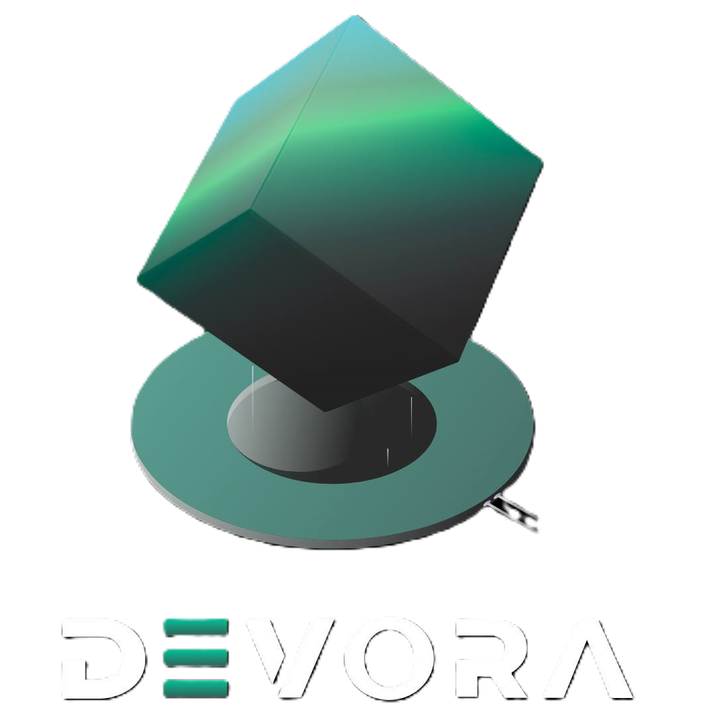

# 🛡️ Hodor (The Gatekeeper)

[](https://nextjs.org/)
[](https://reactjs.org/)
[](https://tailwindcss.com/)
[](https://www.framer.com/motion/)

**Hodor** is a premium, ultra-responsive attendance management system designed as the frontend part of **Devora's Embedded System University Project** at **OTU**. It provides a modern interface for tracking student attendance via RFID/QR, managing records, and empowering students with self-editing capabilities.

<p align="center">
  
</p>

## Visual identity

Hodor's Gatekeeper interface uses a cool navy canvas with glass surfaces and
neon teal active states. Light mode changes to blue-white surfaces and a deeper
green accent; safety states remain red and amber.

| Theme | Canvas / surface | Accent |
|---|---|---|
| Dark | `#060B14` / `#0D1824` | `#00E8A2` |
| Light | `#F0F6FF` / `#FFFFFF` | `#00C47A` |

This repository does not currently include an app screenshot. See the
[visual identity guide](docs/visual-identity.md) and canonical tokens in
[`src/app/globals.css`](src/app/globals.css).

---

## ✨ Key Features

- 📱 **QR-Based Self-Editing**: Students can scan their unique QR codes to update their profiles instantly.
- 📊 **Dynamic Admin Dashboard**: Comprehensive overview of attendance data with real-time updates and lecture management.
- 🌍 **Bilingual Support**: Fully localized interface supporting both **Arabic** and **English** with RTL/LTR transitions.
- 🌓 **Premium UI/UX**: A state-of-the-art design featuring:
  - **Glassmorphism** and high-end aesthetics.
  - **Smooth Transitions** powered by Framer Motion.
  - **Dynamic Dark/Light Mode** tailored for readability and style.
- 🎫 **RFID Integration**: Seamlessly ready to pair with the backend port and RFID hardware module.
- 🎓 **Lecture Lifecycle Management**: Start, pause, and stop lectures with automated status tracking.

---

## 🛠️ Tech Stack

- **Framework**: [Next.js 16 (App Router)](https://nextjs.org/)
- **UI Library**: [React 19](https://reactjs.org/)
- **Styling**: [Tailwind CSS v4](https://tailwindcss.com/)
- **Animations**: [Framer Motion](https://www.framer.com/motion/)
- **Notifications**: [Sonner](https://sonner.emilkowal.ski/)
- **QR Generation**: [qrcode.react](https://www.npmjs.com/package/qrcode.react)
- **Language**: TypeScript

---

## 🚀 Getting Started

### Prerequisites

- Node.js 20+ 
- npm / yarn / pnpm

### Installation

1. **Clone the repository**:
   ```bash
   git clone https://github.com//Omar-Khaled-57/hodor.git
   cd hodor
   ```

2. **Install dependencies**:
   ```bash
   npm install
   ```

3. **Run the development server**:
   ```bash
   npm run dev
   ```

4. **Build for production**:
   ```bash
   npm run build
   ```

### 🔌 Hardware Setup (ESP8266 & RFID)

The scanning system is now fully integrated with Next.js, eliminating the need for a separate PHP (XAMPP) server!

1. Open `hardware/esp8266_nextjs_firmware.ino` in your Arduino IDE.
2. Update `WIFI_SSID` and `WIFI_PASSWORD` at lines 15–16 with your local WiFi credentials. The committed values are a local example; never commit real credentials.
3. Replace the host in `SERVER_URL` on line 17 with your PC's local IP address (e.g., `http://192.168.1.5:3000/api/scan`). Make sure your PC and the ESP8266 are on the same WiFi network.
4. Connect your ESP8266 microcontroller to your PC via USB.
5. Compile and upload the `.ino` firmware to the microcontroller.
6. Start the Next.js server (`npm run dev`). When you scan an RFID card, the ESP8266 will send the UID directly to Next.js and beep!

---

## 📂 Project Structure

```bash
src/
├── app/               # Next.js App Router (pages, API routes, metadata images)
│   ├── [uid]/         # Student self-editing portal
│   ├── all-data/      # Student roster, search and sorting
│   ├── login/         # Admin entry point
│   └── api/           # scan, pending_scan, sync_lecture route handlers
├── components/        # Reusable UI components (Modals, Navbar, etc.)
├── contexts/          # State management providers (store, auth, locale, theme)
├── data/              # Seed students, lectures and demo admin credentials
└── i18n/              # English and Arabic strings
hardware/              # ESP8266 + MFRC522 firmware
```

---

## Documentation

The full documentation set is in [`docs/`](docs/README.md):

| Page | What it covers |
| --- | --- |
| [Product](docs/product.md) | Features and known gaps |
| [Architecture](docs/architecture.md) | Routes, state, API flow and hardware handoff |
| [Development](docs/development.md) | Setup, commands, conventions and troubleshooting |
| [Configuration](docs/configuration.md) | Env var, storage keys, temp files and firmware constants |
| [Testing](docs/testing.md) | No test script; available static checks and manual smoke tests |
| [Deployment](docs/deployment.md) | Build, artifacts and runtime assumptions |
| [Changelog](docs/changelog.md) | Release notes status |
| [Visual identity](docs/visual-identity.md) | Colors and theme tokens |

## Commands

| Command | Script |
| --- | --- |
| `npm run dev` | `next dev` |
| `npm run build` | `next build` |
| `npm start` | `next start` |
| `npm run lint` | `eslint` |

There is no `test` script in `package.json`.

---

## 🤝 The Devora Team

This project is developed with ❤️ by the **Devora Team** at **OTU** as part of the Embedded Systems curriculum.

- **Frontend**: Next.js & React 19
- **Backend**: Next.js API Routes (Migrated from PHP)
- **Hardware**: ESP8266 & MFRC522 RFID Module

---

## 📄 License

Internal University Project - OTU.

A standard MIT [LICENSE](LICENSE) (`Copyright (c) 2026 Omar Khaled`) is included
for the repository; the original project note above is retained.

---

> [!NOTE]
> The system now runs entirely on Next.js, bridging the frontend UI and the ESP8266 hardware seamlessly without third-party backend dependencies.
